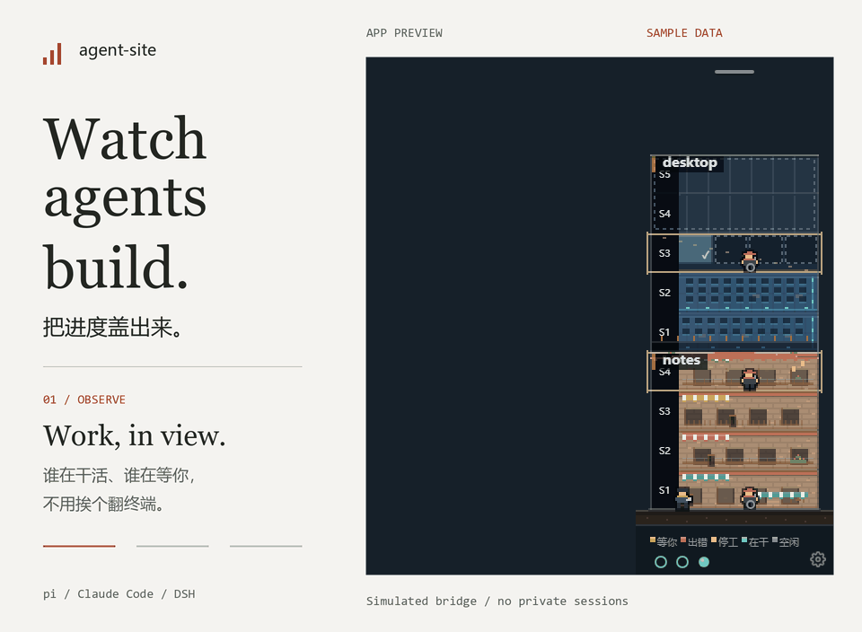

# agent-site

**Your agents work in the terminal. Watch the site from your desktop.**

A pixel-art construction site for pi, Claude Code, and DeepSeek Harness sessions. See who's working, who's stopped, and who needs you—without checking every terminal.

[中文](README.zh-CN.md) · [Quick start](#quick-start) · [Supported agents](#supported-agents) · [Docs](docs/README.md) · [MIT](LICENSE)



*Real app renderer, fictional projects and sessions. The pi bridge interaction is simulated; no live agent or private session is recorded.*

## What it does

- **See the activity.** Sessions become workers. Working, idle, stalled, and waiting states get visible cues. Click a worker for recent actions and session details.
- **Watch progress take shape.** Plan slices or session todos become floors: solid when complete, outlined when pending, occupied while in progress.
- **Stay out of the terminal.** With the pi bridge, pause, resume, interrupt, send suggestions, and answer questions from the desktop.
- **Keep your workspace.** The window sits at the screen edge. Empty areas are click-through, and the building folds into a narrow ribbon when you don't need it.
- **Make it yours.** Choose a tower, factory, or row of storefronts, with light and dark themes. Projects are discovered automatically; pin one to keep it in view.

This isn't an agent launcher or scheduler. Keep using your terminal. Agent-site makes the work visible.

## Quick start

Currently developed and tested primarily on **Windows 11**. The UI is in Chinese, and there is no packaged installer yet.

Requires **Node.js ≥ 22.19** and **Git ≥ 2.31**. Clone the repository, then run:

```bash
cd agent-site
npm install
npm run start:app
```

The app discovers projects from local session logs. No project list is required. With no sessions, it shows an empty site.

### Optional: connect the pi bridge

Monitoring works without the bridge. To control pi, answer questions, or record todos with `site_todo`, use **pi ≥ 1.5** and build the bridge:

```bash
npm run build:bridge
```

**Copy** `dist/bridge/site-bridge.js` to:

```text
%USERPROFILE%\.pi\agent\extensions\site-bridge.js
```

Create the directory if needed. Keep the app running and reopen your pi session. If you already load a bridge from another location, replace that copy instead—don't install two.

**Do not load the file directly from `dist/`.** Builds and tests overwrite it, and a broken extension can prevent pi from starting. To update, rebuild, copy, and restart pi. To uninstall, delete the copy or remove its entry from pi's `extensions` setting. If pi fails to start, use `pi -ne` to skip extensions.

Set `AGENT_SITE_BRIDGE=off` before launching a pi process to disable the bridge for that process and its children. The app can still show their logs in read-only mode.

## Supported agents

| Source | Activity and progress | Pause, suggestions, and answers |
|---|---|---|
| pi | Supported | With the bridge, for top-level sessions and direct children |
| Claude Code | Supported | Read-only |
| DeepSeek Harness | Supported | Read-only |

The pi `site_todo` tool is available only to top-level sessions in watched projects.

### Do I need plan files?

No. Agent-site uses plan slices from `specs/<feature>/spec.md` when available. Otherwise, it uses top-level session todos. Without either, you still get workers and a small one-story building. You don't need to use dev-circuit-ultra to run the app.

Floors show **recorded plan progress**, not a completion percentage guessed from code. Activity states are derived from logs and bridge signals, so they won't catch every stalled run.

## Runs locally

The app reads local session logs and project plans without changing project files. It needs no additional model API key. pi controls connect over localhost only.

Common secret patterns are masked in displayed text. Still review project names, paths, and conversation content before sharing screenshots.

Settings live in `%APPDATA%\agent-site\settings.json`, or in `AGENT_SITE_HOME` when set. Use the gear menu to change the theme, building style, startup behavior, and other settings.

## Development

TypeScript · Electron · Canvas 2D · Vue 3

```bash
npm run typecheck
npm test
npm run build:app
```

To inspect the data without opening the window:

```bash
npm run -s snapshot
```

[Design](docs/design.md) · [Architecture](docs/architecture.md) · [Contributor guide](AGENTS.md) — currently in Chinese.

## License

[MIT](LICENSE) © agent-site contributors.
