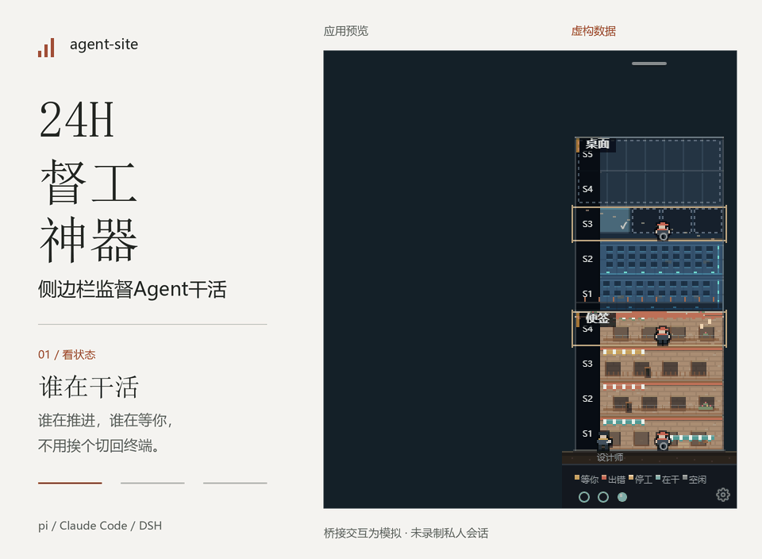

# agent-site

**Agent 在终端干活，你在桌面看工地。**

把 pi、Claude Code 和 DeepSeek Harness 的会话画成一座像素工地。谁在干活、谁停住了、谁在等你，不用挨个翻终端。

[English](README.md) · [快速开始](#快速开始) · [支持范围](#支持范围) · [文档](docs/README.md) · [MIT](LICENSE)



*真实 App 渲染器，虚构项目和会话。桥接交互为模拟数据，没有调用真实 agent，也没有录制私人会话。*

## 能做什么

- **看状态。** 会话变成工人，工作、空闲、停工和等你都有对应提示。点开小人，查看最近动作和会话内容。
- **看进度。** 计划切片或会话待办变成楼层：完成的砌实，没开始的留虚线，正在做的那层站着工人。
- **少切终端。** 接上 pi 桥接后，可以暂停、继续、中断、给建议，也能直接回答 agent 的提问。
- **不挡工作。** 小窗贴在屏幕边缘，透明空白可穿透；不用时收成彩带，有事再展开。
- **换个工地。** 塔楼、厂房、临街店三种造型，支持明暗主题。多个项目自动识别，也可以钉住一个看。

它不替你启动或调度 agent。继续用你熟悉的终端，工地负责把正在发生的事画出来。

## 快速开始

针对 **Windows 11 x64** 开发和验证，支持**简体中文和英文界面**。

### 便携桌面版

从 [Releases](https://github.com/iswalterwu/agent-site/releases) 下载便携 ZIP，**完整解压**后运行 `AgentSite.exe`，不必另装 Node.js、npm 或 Electron。[安装、校验、未签名提示与回滚说明](docs/distribution.zh-CN.md)。如果 Release 中暂未列出安装文件，可以使用下面的源码方式。

可选的 `dsh-agent-site` 插件能从本机 DSH 打开这个独立小窗。将预构建 `.tgz` 装到实际使用的 DSH 实例/profile，保存已解压程序的路径即可。桌面组件需单独下载，DSH 仍是只读监控。[DSH 插件说明](packages/dsh-plugin/README.zh-CN.md)。

### 从源码启动

需要 **Node.js ≥ 22.19**、**Git ≥ 2.31**。克隆仓库后运行：

```bash
cd agent-site
npm install
npm run start:app
```

App 会从本机的会话日志自动发现项目，不必先配项目列表。没有会话时显示空工地。

### 可选：接上 pi 桥接

不装桥接也能看状态。要控制 pi、回答提问或使用 `site_todo` 记录待办，需要 **pi ≥ 1.5**，并安装桥接：

```bash
npm run build:bridge
```

将 `dist/bridge/site-bridge.js` **复制一份**到：

```text
%USERPROFILE%\.pi\agent\extensions\site-bridge.js
```

目录不存在就先创建。保持 App 运行，重新打开 pi 会话。如果已经从其他位置加载桥接，更新那份副本即可，不要同时装两份。

**不要让 pi 直接加载 `dist/` 中的文件。** 构建和测试会改写它，扩展损坏可能导致 pi 无法启动。更新桥接时重新构建、复制并重启 pi；卸载时删除副本，或移除 pi 设置里对应的 `extensions` 项。如果 pi 启动失败，可以先用 `pi -ne` 跳过扩展。

启动某个 pi 进程前设置 `AGENT_SITE_BRIDGE=off`，可以为它和子进程关闭桥接；App 仍可从日志显示它们的只读状态。

## 支持范围

| 来源 | 查看状态与进度 | 暂停、建议、回答提问 |
|---|---|---|
| pi | 支持 | 安装桥接后支持一级、二级会话 |
| Claude Code | 支持 | 只读 |
| DeepSeek Harness | 支持 | 只读 |

pi 的 `site_todo` 工具只提供给被监视项目中的一级会话。

### 没有计划文件，也能用吗？

能。有符合格式的 `specs/<feature>/spec.md` 时按切片画楼；没有时用一级会话的待办。两者都没有，仍会显示工人和一层矮楼。不用先接入 dev-circuit-ultra。

楼层反映的是**记录下来的计划进度**，不是从代码量猜出来的完成百分比；工作状态也来自日志和桥接信号，不保证能识别所有卡住的情况。

## 本地运行

App 在本机读取会话日志和项目计划，不修改项目文件，也不需要额外配置模型 API key。pi 的控制连接只走本机。

显示文字会遮住常见密钥格式；分享截图前，仍请检查项目名、路径和会话内容。

设置文件在 `%APPDATA%\agent-site\settings.json`；设了 `AGENT_SITE_HOME` 就在该目录下。设置里可选**跟随系统、简体中文或 English**，保存后当场切换。默认跟随系统：中文系统用中文，其余用英文；项目名和会话内容保留原文。齿轮菜单也能修改配色、楼体造型、开机自启等设置。

## 开发

TypeScript · Electron · Canvas 2D · Vue 3

```bash
npm run typecheck
npm test
npm run build:app
```

只想查看数据、不打开窗口：

```bash
npm run -s snapshot
```

[设计说明](docs/design.md) · [架构](docs/architecture.md) · [开发入口](AGENTS.md)

## 许可

[MIT](LICENSE) © agent-site contributors。
