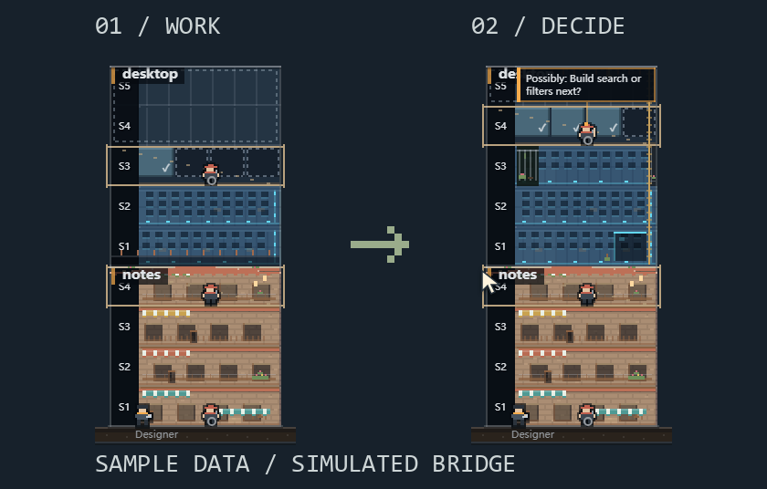

# Agent Site for DSH

[简体中文](README.zh-CN.md)

Open a local Windows desktop pixel monitor for pi, Claude Code and DeepSeek Harness sessions. **DSH is read-only.** This plugin opens a separate app; it is not an embedded agent runner or a model tool.

## Install

1. Download `dsh-agent-site-<version>.tgz` and the matching Windows x64 desktop ZIP from [Releases](https://github.com/iswalterwu/agent-site/releases). Check `SHA256SUMS` and fully extract the desktop ZIP.
2. In DSH Desktop, install the `.tgz` with **its own plugin manager**. For local `dsh web`, use `dsh plugin --profile <profile> add <absolute-path-to-plugin.tgz>` with the profile you actually run.
3. Open the plugin page, enter the extracted `AgentSite.exe` path, **Save**, then **Open Agent Site**.

Tested DSH versions: **`0.2.1-rc.3` and `0.2.2-rc.1`**. Windows 11 x64, local host only. The portable desktop build is **unsigned**. If no release file is listed, do not assume a download is already available.

Installing the bundle does not download/start the desktop component or enable startup at login. It uses the host's resolved DSH data root; no model requests, telemetry, background downloads or additional listening service are added.

## Remove and roll back

Disable or uninstall using DSH's plugin manager. An opened desktop window keeps running independently. Close it separately, turn its startup-at-login setting off, and then remove or replace the portable folder. App data and Harness sessions are preserved; the pi bridge is not changed.

[Full installation, data-root, troubleshooting and rollback guide](https://github.com/iswalterwu/agent-site/blob/main/docs/distribution.md).
