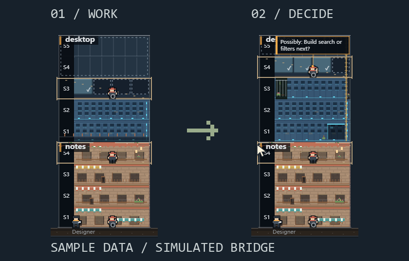

# Agent Site：DSH 工地入口

[English](README.md)

从本机 DSH 打开 Windows 桌面像素会话监控，查看 pi、Claude Code 和 DeepSeek Harness 的进展。**DSH 为只读监控**；插件打开的是独立 App，不是内嵌 agent 运行器或模型工具。

## 安装

1. 从 [Releases](https://github.com/iswalterwu/agent-site/releases) 下载 `dsh-agent-site-<version>.tgz` 和同版本 Windows x64 桌面 ZIP，比对 `SHA256SUMS`，完整解压桌面 ZIP。
2. DSH Desktop 请用**客户端自己的插件管理器**安装 `.tgz`；本机 `dsh web` 使用 `dsh plugin --profile <profile> add <插件.tgz的绝对路径>`，profile 要与实际启动时一致。
3. 进入插件页，填入解压目录中的 `AgentSite.exe`，**保存**后点击**打开工地**。

已验证的 DSH 版本：**`0.2.1-rc.3`、`0.2.2-rc.1`**。仅支持 Windows 11 x64 本机宿主，桌面便携版**未签名**。Release 尚未列出文件时，不代表已经有可下载的制品。

安装插件不会下载或启动桌面组件，也不会开启开机启动。入口使用宿主解析后的 DSH 数据根，不新增模型请求、遥测、后台下载或监听服务。

## 卸载与回滚

用 DSH 插件管理器禁用或卸载。已打开的小窗独立运行，需要时单独退出；移走或替换便携目录前先关闭 App 的开机启动。App 数据、Harness 会话会保留，pi 桥接不受影响。

[完整安装、数据根、排障与回滚说明](https://github.com/iswalterwu/agent-site/blob/main/docs/distribution.zh-CN.md)。
